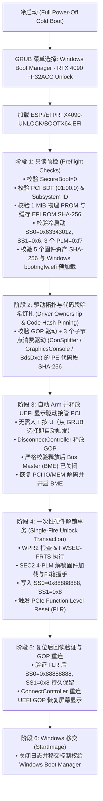

# RTX 4090 (AD102) Windows UEFI + GRUB FP32ACC Unlock Port

[](source/LICENSES/GPL-2.0.txt)
[](#)
[](#)

面向 **NVIDIA GeForce RTX 4090 (`10de:2684`, AD102)** 的 **Windows UEFI 预引导（GRUB 链式加载）FP32 累加（Tensor Core FP16/BF16/TF32/FP8 -> FP32 Accumulate）满血解锁工程**。

本项目在进入 Windows Boot Manager（`bootmgfw.efi`）之前，通过一个极度收敛、默认 Fail-Closed（失败即拒绝，绝不盲写硬件）的 UEFI 应用程序完成一次性 SEC2 4-PLM 解锁事务，把 AD102 的 `NV_SSE_SE_SWITCH_DISP_FP32_ACC_ALLOW` 状态从冷启动锁定的 `0x63343012 / 0x6` 翻转为 `0x88888888 / 0x8`，执行 PCIe FLR（Function Level Reset），重连 UEFI GOP 显示驱动后，无缝移交控制权给 Windows。

---

## 目录

1. [工作原理与执行流](#1-工作原理与执行流)
2. [项目目录结构](#2-项目目录结构)
3. [硬件钉扎参数说明与实机算力实测](#3-硬件钉扎参数说明与实机算力实测)
4. [快速开始：编译、模拟验证与部署（Windows + GRUB）](#4-快速开始编译模拟验证与部署windows--grub)
5. [如何移植到其他 RTX 4090（非公版 / 不同主板）完整指南](#5-如何移植到其他-rtx-4090非公版--不同主板完整指南)
6. [冷启动操作流程、日志判读与故障恢复](#6-冷启动操作流程日志判读与故障恢复)
7. [开源合规、禁止上传清单与致谢](#7-开源合规禁止上传清单与致谢)

---

## 1. 工作原理与执行流



---

## 2. 项目目录结构

```text
rtx4090-win-grub-unlock/
├── README.md                          # 项目说明、部署指南与跨板卡移植手册（本文档）
├── LOCAL-STATUS.md                    # 当前板卡适配状态与离线模拟验证记录
├── build.py                           # 主编译脚本（支持 Zig 内置工具链或 Clang/lld-link）
├── build-inert-zig.py                 # 编译默认不触碰硬件的 Inert 验证版 EFI
├── run-core-sim-zig.py                # 43 个 AD102 核心状态机/PCI/MMIO/DMA 纯软件模拟测试
├── run-app-sim-zig.py                 # 51 个完整 UEFI 引导+驱动哈希篡改拦截+策略模拟测试
├── verify-captured-child.py           # 离线校验采集到的 UEFI GOP 与子节点驱动 PE 代码哈希
├── stage-esp.py                       # 一键校验资产哈希并生成 dist/esp 与 dist/grub 部署包
├── Deploy-Esp.ps1                     # 管理员 PowerShell 脚本：自动挂载 ESP 并部署解锁文件
├── bench-gemm.py                      # PTX mma.sync 指令级吞吐 + PyTorch cuBLAS GEMM 算力验证脚本
├── provenance.json                    # 上游源码 SHA-256 溯源记录
└── source/
    ├── deps/edk2/                     # 最小化 EDK2 MdePkg 头文件依赖（BSD-2-Clause-Patent）
    ├── LICENSES/                      # GPL-2.0、BSD-2-Clause-Patent、MIT 许可证原文
    └── unlock/
        ├── app.c                      # UEFI 入口、预检流程、自动 Arm 与主状态机
        ├── app_io.c                   # 5 个固件资产 SHA-256 钉扎、ESP 卷定位与 RUNxx 日志系统
        ├── ownership.c / ownership.h  # UEFI 驱动拓扑快照、4 个驱动 PE 代码段哈希校验与释放/重连
        ├── handoff.inc                # 释放驱动 -> PCI 恢复 -> 解锁 -> FLR -> 重连 -> StartImage
        ├── checks.c                   # PCI BAR、PCIe Cap、256B 配置空间一致性与后置快照断言
        ├── port.c / port.h            # 板卡硬件常量（BDF、Subsystem、ROM 哈希、寄存器偏移）
        ├── prom_profile.h             # 1 MiB 物理 PROM 布局与归一化 SHA-256 校验算法
        ├── pe_driver.h                # UEFI 驱动内存 PE/COFF 头部与代码段提取校验器
        ├── child_graph.h              # GPU 子句柄（ConOut / GOP / EdidDiscovered）拓扑验证器
        ├── storage_path.h             # GPT 分区 GUID 设备路径解析器
        ├── local_profile.h            # 公开安全网关头（自动按需加载 local/local_profile.h）
        ├── local_profile.example.h    # 分区 GUID 配置模板（供新用户复制修改）
        ├── vendor/                    # AD102 610.43.03 固件加载、FWSEC-FRTS、Booter、SEC2 实现
        └── tests/                     # 宿主机纯软件模拟测试套件（无需触碰物理硬件即可验证全部分支）
```

---

## 3. 硬件钉扎参数说明与实机算力实测

本工程采用强硬件特征钉扎机制，以下为各配置项的作用及对应源码修改位置（涉及具体板卡 VBIOS/ROM、主板驱动及磁盘分区的敏感指纹均已脱敏）：

| 配置项 | 示例 / 通用说明 | 对应源码位置 |
| :--- | :--- | :--- |
| **目标 GPU** | NVIDIA GeForce RTX 4090 (`10de:2684`, rev `a1`) | [`port.h`](source/unlock/port.h) |
| **Subsystem ID** | `10de:xxxx`（根据具体 AIC 品牌子系统 ID 钉扎） | [`port.h`](source/unlock/port.h#L16) (`KOH_SUBSYS_PIN`) |
| **PCI 位置 (Seg:Bus:Dev.Func)** | `0000:01:00.0` (Audio: `0000:01:00.1`) | [`port.h`](source/unlock/port.h#L14-L15) |
| **辅助显示设备 (iGPU)** | 主板核显 / 副卡 PCI ID 白名单（如 Intel UHD `8086:xxxx`） | [`app.c`](source/unlock/app.c#L88) (`DisplayCheck`) |
| **芯片与显存特征** | `PMC_BOOT_0 = 0x192000a1`, `FB_SIZE_MB = 0x5ff4` (24 GiB) | [`port.h`](source/unlock/port.h#L17-L18) |
| **冷启动锁状态** | `SS0 = 0x63343012`, `SS1 = 0x6`, 3 个 PLM = `0x000000f7` | [`port.h`](source/unlock/port.h#L19-L26) |
| **缓存 EFI ROM 哈希** | `<YOUR_CACHED_EFI_ROM_SHA256>`（由本机 VBIOS GOP 切片计算） | [`app.c`](source/unlock/app.c#L25) (`ExpectedRomHash`) |
| **1 MiB 物理 PROM 哈希** | `<YOUR_NORMALIZED_1M_PROM_SHA256>`（由 `BAR0+0x300000` 计算） | [`prom_profile.h`](source/unlock/prom_profile.h#L9-L16) |
| **UEFI 驱动代码段钉扎** | GOP + ConSplitter + GraphicsConsole + BdsDxe 四驱动 PE 代码段 SHA-256 | [`ownership.c`](source/unlock/ownership.c#L17-L22) (`DriverPins`) |
| **ESP 分区 (FAT32)** | `/dev/nvmeXnYpZ`, FAT UUID `<XXXX-XXXX>`, GPT Partition GUID | `source/unlock/local/local_profile.h` (本地 gitignore) |

### 实机硬件验证与算力对比 (`bench-gemm.py`)

已在实机（Windows 11 + NVIDIA 驱动 616.64 + PyTorch 2.7.0+cu126）冷启动完成 `RUN01` 一次性 SEC2 4-PLM 解锁、FLR 复位、GOP 重连与 Windows 移交验证（`POST-FLR SS0=0x88888888 SS1=0x00000008`，`FINAL status=0 clean=1`）：

| 测试项目 (`python bench-gemm.py`) | 未解锁 (Locked) | 解锁后实测 (Unlocked) | 提升幅度 |
| :--- | :---: | :---: | :---: |
| **PTX `mma.sync` `FP16 -> FP16` (m16n8k16)** | ~301.38 TFLOPS | **301.38 TFLOPS** | 基准全速 |
| **PTX `mma.sync` `FP16 -> FP32` (m16n8k16)** | ~150–165 TFLOPS (锁半速) | **299.98 TFLOPS** | **+99% (1.00x 全速)** |
| **PTX `mma.sync` `BF16 -> FP32` (m16n8k16)** | ~150–165 TFLOPS (锁半速) | **327.05 TFLOPS** | **+98% (满血)** |
| **PTX `mma.sync` `TF32 -> FP32` (m16n8k8)** | ~82.6 TFLOPS (锁半速) | **163.53 TFLOPS** | **+98% (满血)** |
| **PyTorch `torch.mm` `BF16` (`2048³`, FP32 累加)** | ~136 TFLOPS (硬顶 165.2) | **224.90 TFLOPS** | **突破硬顶 (+65%)** |
| **PyTorch `torch.mm` `FP16` (`4096³`, FP32 累加)** | ~146 TFLOPS (硬顶 165.2) | **204.99 TFLOPS** | **突破硬顶 (+40%)** |
| **PyTorch `torch.mm` `TF32` (`6144³`, FP32 累加)** | ~75 TFLOPS (硬顶 82.6) | **117.46 TFLOPS** | **突破硬顶 (+56%)** |
| **PyTorch `torch._scaled_mm` `FP8` (`2048³`, FP32 累加)** | ~240 TFLOPS (硬顶 330.3) | **333.89 TFLOPS** | **突破硬顶 (+39%)** |

### 离线测试验证状态
- `python build-inert-zig.py`：**通过**（生成默认安全版 `INERT-AD102.EFI`）
- `python run-core-sim-zig.py`：**43 / 43 场景全部通过**（模拟 PCI / MMIO / DMA / WPR2 / FWSEC-FRTS / Booter / SEC2 / FLR）
- `python run-app-sim-zig.py`：**51 / 51 应用与核心场景 + 2 个子节点拓扑篡改拦截 + 4 个驱动代码段单字节篡改拦截 + 7 个安全策略场景全部通过**
- `python verify-captured-child.py`：**通过**（离线校验采集的 GOP 与 3 个消费驱动 PE 代码哈希一致）
- `python build.py --enable-experiment`：**通过**（生成激活版 `source/build/BOOTX64.EFI`，PE/COFF 重定位与安全头断言通过）

---

## 4. 快速开始：编译、模拟验证与部署（Windows + GRUB）

### 4.1 环境要求
- **Python 3.10+**
- **编译器（二选一）**：
  - 仓库自带免安装工具链：`..\toolchain\ziglang\zig.exe`（`build.py` 会自动检测并使用 `zig cc`），或
  - 系统安装的 `clang` + `lld-link`（LLVM 16+）。

### 4.2 配置本机 ESP 分区 GUID
复制模板头文件并填入本机 Windows ESP 分区的 GPT 分区 GUID（该目录已被 `.gitignore` 忽略，不会被提交到 Git）：

```powershell
New-Item -ItemType Directory -Force source\unlock\local
Copy-Item source\unlock\local_profile.example.h source\unlock\local\local_profile.h
# 编辑 source\unlock\local\local_profile.h 填入你的 GPT Partition GUID 和分区号
```

> 在 Windows PowerShell 中查看 ESP 分区 GPT GUID 的快捷命令：
> ```powershell
> Get-Partition | Where-Object { $_.GptType -eq '{c12a7328-f81f-11d2-ba4b-00a0c93ec93b}' } | Select-Object DiskNumber, PartitionNumber, Guid
> ```

### 4.3 编译激活版 `BOOTX64.EFI` 并打包 ESP 与 GRUB 配置

```powershell
# 1. 编译激活版 UEFI 解锁程序（输出至 source/build/BOOTX64.EFI）
python build.py --enable-experiment

# 2. 校验 5 个固件资产 SHA-256 并生成 dist/esp 与 dist/grub 部署包
python stage-esp.py --esp-uuid <YOUR-ESP-FAT-UUID>
```

执行成功后，`dist/` 目录下会生成：
- `dist/esp/EFI/RTX4090-UNLOCK/BOOTX64.EFI`：编译好的 UEFI 解锁引导程序
- `dist/esp/RTX4090-UNLOCK/ASSETS/*`：5 个通过 SHA-256 严格校验的固件文件
- `dist/grub/grub-unlock-entry.cfg`：可直接追加到 GRUB 的菜单项
- `dist/grub/five-entry-menu.cfg`：整合好的完整 5 项 GRUB 菜单配置

### 4.4 一键部署到 ESP 分区（Windows 管理员权限）

在 **管理员 PowerShell** 中运行：

```powershell
powershell -ExecutionPolicy Bypass -File .\Deploy-Esp.ps1
```

该脚本会自动使用 `mountvol S: /S` 临时挂载 EFI 系统分区，验证 `\EFI\Microsoft\Boot\bootmgfw.efi` 存在后，将 `\EFI\RTX4090-UNLOCK\BOOTX64.EFI` 和 `\RTX4090-UNLOCK\ASSETS\*` 复制到位并校验 SHA-256，最后自动卸载盘符。

部署后的 ESP 分区目录结构如下：
```text
(ESP 分区根目录, FAT32 UUID: XXXX-XXXX)
├── EFI/
│   ├── Microsoft/Boot/bootmgfw.efi          # 原生 Windows Boot Manager（保持原样，切勿覆盖！）
│   └── RTX4090-UNLOCK/
│       └── BOOTX64.EFI                      # 本项目编译的 RTX 4090 解锁加载器
└── RTX4090-UNLOCK/
    ├── ASSETS/
    │   ├── booter_load_ad102.bin            # 57,672 bytes
    │   ├── v67-ad102-610.43.03-four-plm.bin # 64,000 bytes
    │   ├── gsp_ga10x.bin                    # 84,277,400 bytes
    │   ├── gsp_boot_ad102.bin               # 36,864 bytes
    │   └── gsp_boot_desc_ad102.bin          # 84 bytes
    └── RUN00/                               # 每次运行自动创建的日志目录（RUN00..RUN99）
        └── REPORT.TXT                       # 完整预检、寄存器前后状态与解锁结果报告
```

### 4.5 配置 GRUB 引导菜单

在 Ubuntu / Linux 下将 `dist/grub/grub-unlock-entry.cfg` 的内容加入 `/etc/grub.d/40_custom`（或更新 `/boot/grub/grub.cfg`）：

```grub
menuentry 'Windows Boot Manager - RTX 4090 FP32ACC Unlock' --class windows --class os --id rtx4090-windows-unlock {
    insmod part_gpt
    insmod fat
    insmod chain
    search --no-floppy --fs-uuid --set=unlock <YOUR-ESP-FAT-UUID>
    chainloader ($unlock)/EFI/RTX4090-UNLOCK/BOOTX64.EFI
}
```
在 Ubuntu 中执行 `sudo update-grub` 即可生效。原有的 `Windows Boot Manager` 菜单项保持不变，随时可以绕过解锁直接原生启动 Windows。

---

## 5. 如何移植到其他 RTX 4090（非公版 / 不同主板）完整指南

本工程采用 **强硬件指纹钉扎（Fail-Closed Pinning）** 设计：当 VBIOS 版本、品牌子系统 ID、PCI 槽位或主板 UEFI GOP 驱动不同，程序会在只读预检阶段安全停止并输出精确原因，绝不会在未知状态下写寄存器。

如果你需要将本项目移植到另一张 RTX 4090（不同 AIC 品牌/VBIOS）或另一块主板，只需按以下 **5 个步骤** 替换钉扎常量：

### 第 1 步：使用只读硬件探针（`probe-internal`）采集本机冷启动快照
1. 编译 `probe-internal` 目录下的只读探针 `AD102-PROBE.EFI`（绝不执行任何解锁写入）。
2. 从**完全断电冷启动**进入 `AD102-PROBE.EFI`，它会在 ESP 分区生成 `CAP000x.JSON` 以及只读转储。
3. 运行 `python ..\probe-internal\prepare-private-profile.py` 提取：
   - 256 字节 PCI 配置空间 (`pci-config-256.bin`)
   - 归一化 1 MiB 物理 PROM (`normalized-prom-1m.bin`) 与缓存 EFI ROM (`cached-efi-rom.bin`)
   - 4 个 UEFI 驱动的 PE 代码段哈希

### 第 2 步：更新硬件标识与 ROM 哈希（`port.h`、`prom_profile.h`、`app.c`）
根据采集到的 `CAP000x.JSON` 修改以下 3 处：
1. **[`source/unlock/port.h`](source/unlock/port.h)**：
   - `KOH_BUS_PIN` / `KOH_DEV_PIN`：目标显卡所在的 PCIe Bus/Device（如 `0x01` / `0x00`）。
   - `KOH_SUBSYS_PIN`：你的显卡 Subsystem Vendor + Device ID（如 `0x16f310deU`）。
2. **[`source/unlock/app.c`](source/unlock/app.c)**：
   - `ExpectedRomHash`（第 25 行）：替换为 `CAP000x.JSON` 中的 `cached_efi_rom_sha256`，并在 `RomCheck()` 中更新 `RomSize`（如 `0x24a00`）。
   - `DisplayCheck()`（第 88 行）：如果你的主板开启了核显或副卡，将其 PCI ID（如 Intel `0xa7808086U`）加入白名单。
3. **[`source/unlock/prom_profile.h`](source/unlock/prom_profile.h)**：
   - `KOH_EXPECTED_PROM_SHA256`：替换为你的 1 MiB 物理 PROM 归一化 SHA-256。

### 第 3 步：更新主板 UEFI 驱动 PE 代码哈希（`ownership.c`）
打开 [`source/unlock/ownership.c`](source/unlock/ownership.c#L17-L22)，将 `DriverPins[4]` 数组中的大小（`ImageSize`、`SizeOfCode`）与 SHA-256 替换为你主板采集到的 4 个驱动值：
- `DriverPins[0]`：NVIDIA UEFI GOP Driver（绑定在 GPU 控制器上）
- `DriverPins[1]`：`ConSplitterDxe`（打开 GPU 子节点 Text Out 协议）
- `DriverPins[2]`：`GraphicsConsoleDxe`（打开 GPU 子节点 GOP 协议）
- `DriverPins[3]`：`BdsDxe`（打开 GPU 子节点 `EdidDiscovered` 协议）

### 第 4 步：准备 5 个固件资产并更新 `app_io.c`（如使用不同提取批次）
5 个固件文件来自 [gpu-unlock-ada](https://github.com/notfromstatefarm/gpu-unlock-ada) 针对 NVIDIA 610.43.03 驱动提取的 AD102 固件包：
- `booter_load_ad102.bin`
- `v67-ad102-610.43.03-four-plm.bin`
- `gsp_ga10x.bin`
- `gsp_boot_ad102.bin`
- `gsp_boot_desc_ad102.bin`

如果它们的 SHA-256 与 [`source/unlock/app_io.c`](source/unlock/app_io.c#L18-L24) 中的 `Specs[]` 一致则无需修改；若重新生成后哈希不同，同步更新 `app_io.c` 与 `stage-esp.py` 中的哈希列表。

### 第 5 步：运行宿主机全套纯软件模拟验证
在触碰真实硬件前，先在 Windows/Linux 宿主机上运行模拟测试：
```powershell
python verify-captured-child.py
python run-core-sim-zig.py
python run-app-sim-zig.py
```
全部绿灯通过后，再按第 4 节执行 `python build.py --enable-experiment` 和 `python stage-esp.py`。

---

## 6. 冷启动操作流程、日志判读与故障恢复

### 6.1 为什么必须从冷启动（Cold Boot）进入？
NVIDIA Ada 架构的 FWSEC-FRTS 与 Booter/SEC2 在每次上电周期内具有单次状态机约束（例如热重启后 `SS0/SS1` 已改变或 PLM 掩码已锁死）。
- **正确姿势**：关机（Shut Down）-> 等待电源完全断电 5~10 秒 -> 按开机键 -> 在 GRUB 菜单选择 **`Windows Boot Manager - RTX 4090 FP32ACC Unlock`**。
- 如果从 Windows 或 Linux 直接“重启（Reboot）”进入，预检会检测到寄存器不是冷启动初始值，并安全拒绝执行（此时可在 GRUB 选择原生 `Windows Boot Manager` 正常进系统，或者关机断电重来）。

### 6.2 全自动无感引导说明
当你在 GRUB 菜单选择了 `Windows Boot Manager - RTX 4090 FP32ACC Unlock` 后，`BOOTX64.EFI` 完成所有只读预检且全部显示 `OK` 后会**直接自动执行（无需再手动按 `U` 键）**：自动释放 UEFI GOP 驱动、执行 AD102 SEC2 解锁、触发 FLR 复位、重连显示并直接引导进入 Windows。
（如果你不想解锁，直接在 GRUB 菜单选择原生的 `Windows Boot Manager` 即可。）

### 6.3 检查解锁报告与算力验证
1. **查看运行日志**：进入 Windows 后，挂载 ESP 分区即可在 `\RTX4090-UNLOCK\RUN00\REPORT.TXT`（每次启动递增 `RUN01`, `RUN02`...）查看完整诊断报告。成功解锁时报告末尾会记录：
   - `POST-FLR SS0=0x88888888 SS1=0x00000008`
   - `POST-GOP SS0=0x88888888 SS1=0x00000008`
   - `FINAL status=0 stage=post-unlock-handoff attempted=1 driver_release=1 clean=1`
2. **Windows 下验证 FP32 累加满血算力**：
   运行仓库自带的 [`bench-gemm.py`](bench-gemm.py)：
   ```powershell
   python bench-gemm.py
   ```
   - **未解锁 RTX 4090**：FP16/BF16 Tensor Core (FP32 Accumulate) 被限制在约 **~165 TFLOPS**。
   - **已解锁 RTX 4090**：FP16/BF16 Tensor Core (FP32 Accumulate) 恢复完整 **~300–330 TFLOPS**（翻倍）。

### 6.4 故障恢复（Recovery）
- **预检失败（Pre-release Refusal）**：未对 GPU 或 PCI 做任何写入，按任意键返回 GRUB，或直接选择原版 `Windows Boot Manager` 即可进入系统。
- **解锁中途停止（Armed Halt）**：若在释放 GOP 驱动之后发生硬件状态异常，程序为保护系统绝不会强行启动 Windows，而是安全停机（Halt）。此时只需**长按电源键关机，断电 10 秒后重新开机**，GPU 即完全恢复初始出厂状态（本方案只修改单次上电周期的易失性寄存器，**绝不刷写或修改显卡物理 VBIOS Flash**）。

---

## 7. 开源合规、禁止上传清单与致谢

### 禁止上传到 GitHub 的文件（已配置在 `.gitignore` 中）
在执行 `git add` / `git commit` 前，请确保**绝对不要**强制添加以下内容：
- `private-assets/` 或 `dist/` 中的任何 `.bin` 固件文件（属于 NVIDIA 专有固件二进制）
- `private-captures/` 中的本机 PROM / VBIOS 镜像与内存驱动转储
- `source/unlock/local/local_profile.h`（包含你个人电脑的硬盘 GPT 分区 GUID）
- `source/build/` 或 `source/build-inert/` 中编译产出的 `.EFI` / `.obj` / `.exe` 二进制

### 许可证与致谢
- 本项目采用 **GPL-2.0-only** 许可证发布（详见 [`source/LICENSES/GPL-2.0.txt`](source/LICENSES/GPL-2.0.txt)）。
- 底层 Ada SEC2 / Booter 610.43.03 解锁序列源自 [notfromstatefarm/gpu-unlock-ada](https://github.com/notfromstatefarm/gpu-unlock-ada) 与 [TOTORONG/AD103_win_unlocker](https://github.com/TOTORONG/AD103_win_unlocker)。
- Windows UEFI 预检架构与主机模拟测试框架源自 [KohakUnlock](https://github.com/KohakuBlueLeaf/KohakUnlock)（见 [`provenance.json`](provenance.json)）。
- `source/deps/edk2` 包含来自 TianoCore EDK2 `MdePkg` 的头文件（遵循 BSD-2-Clause-Patent 许可证）。
